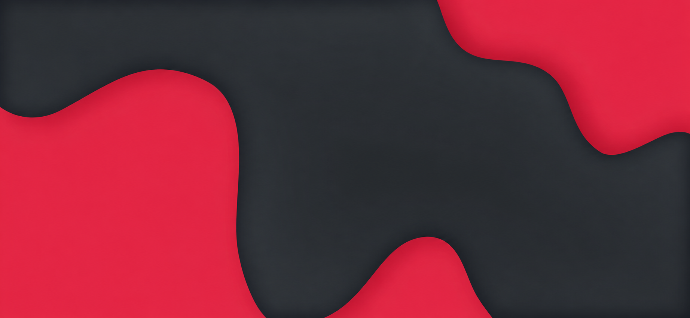

# Papirus Breeze Dark

Este pacote faz parte do repositório unificado **Papirus Breeze**, na pasta
`dark/`. Os exemplos abaixo partem desta pasta; da raiz do repositório,
prefixe os caminhos dos scripts com `dark/`. A documentação compartilhada
fica em `docs/` na raiz. O arquivo de distribuição continua instalável sozinho.

Variação escura do Papirus Breeze Light, com destaque **vermelho `#E93D58`**.
Pacote independente para KDE Plasma 6, preparado em 16 de outubro de 2026.



## Aparência

| Componente | Versão Dark |
| --- | --- |
| Tema global | Papirus Breeze Dark (`com.delta.papirus-breeze-dark`) |
| Cores | Breeze Dark, superfícies cinza-carvão, destaque vermelho `#E93D58` |
| Texto / seleção | Texto claro; seleção vermelha clara com texto escuro para legibilidade |
| Estilo Qt / Plasma | Breeze / `PapirusBreezeRed`, acompanhando o esquema escuro |
| GTK | Breeze-Dark, preferência por tema escuro |
| Ícones | Papirus-Dark com pastas Papirus Red |
| Decoração | Amy Papirus Dark, adaptação da Amy Light com as mesmas proporções |
| Cursor | Breeze Light (`Breeze_Light`), 18 px |
| Fonte | Noto Sans 10 pt |
| Wallpaper, bloqueio e login | Moe Dark, 1844 × 853, carvão e vermelho |
| Painéis opcionais | Inferiores, flutuantes, 32 px, um por monitor conectado |
| Animações | Fator KDE `0.25` |

O complemento de ícones `PapirusBreezeDark` inclui os 835 aliases de pastas, ícones vermelhos do sistema e herda os
outros ícones do Papirus-Dark instalado. Os IDs de tema, ícones, wallpaper e
decoração são próprios da versão Dark, permitindo instalar as duas versões lado
a lado. A variante usa o vermelho do conjunto original.

## Dependências

- Linux com KDE Plasma 6 e Python 3.9 ou superior.
- Breeze, Breeze-Dark para GTK, suporte Aurorae e cursor `Breeze_Light`.
- Papirus-Dark, Noto Sans e tema de sons Ocean, fornecidos pela distribuição.
- Para aplicar: `kwriteconfig6`, `qdbus6`, `plasma-apply-lookandfeel`,
  `plasma-apply-colorscheme`, `plasma-apply-desktoptheme` e
  `plasma-apply-cursortheme`.
- Para login: Plasma Login Manager, ou SDDM com o tema Breeze instalado.

O instalador não baixa arquivos nem instala dependências automaticamente.

## Instalar

No terminal da sessão Plasma do usuário de destino:

```bash
python3 install.py --check
python3 install.py --apply --dry-run
python3 install.py --apply
```

O último comando instala os assets e aplica cores, decoração, fonte, cursor,
integração GTK, wallpaper, bloqueio, Konsole e Fish. Atualiza também o ícone
dos lançadores existentes; a estrutura dos painéis atuais é mantida. Reinicie a
sessão para que todos os aplicativos atualizem o visual.

Para também reproduzir os painéis:

```bash
python3 install.py --apply --layout
```

**`--layout` substitui os painéis atuais.** Cria um painel inferior flutuante de
32 px por monitor conectado, com lançador, paginador, tarefas por ícones,
separador, bandeja, relógio e mostrar desktop. Nenhum painel contém aplicativos fixados. O lançador usa o SVG próprio `papirus-breeze-launcher`, incluído no pacote.

Para disponibilizar o tema sem aplicar:

```bash
python3 install.py
```

Ele aparecerá em Configurações do Sistema → Cores e temas → Tema global.
Use `--apply` para incluir wallpaper, bloqueio e GTK. Na interface, marque **Desktop and window layout** para aplicar os painéis de 32 px, um por monitor e sem aplicativos fixados. Deixe essa opção desmarcada para preservar os painéis existentes.

Os scripts respeitam `XDG_DATA_HOME`, `XDG_CONFIG_HOME` e `XDG_STATE_HOME`.
Não importam contas, programas padrão, IDs de monitores ou configurações de
autenticação do sistema original. Night Color, escalas de monitores e tiling
continuam sob controle do destino. O splash utiliza o padrão Breeze.

## Tela de login

O instalador configura aparência completa para Plasma Login Manager ou SDDM:
paleta, destaque vermelho, ícones, cursor e wallpaper. Os recursos necessários
ficam acessíveis à conta do greeter, mesmo com a pasta pessoal do usuário privada.
A interface de autenticação continua sendo a nativa Breeze.

```bash
python3 install-login.py --dry-run
sudo python3 install-login.py
```

Para acompanhar as trocas entre Light/Dark de um usuário:

```bash
sudo python3 install-login.py --follow-user nome-do-usuario
```

Instale as duas variantes com essa opção. No repositório unificado, o comando
`sudo python3 tools/install-login.py --follow-user "$USER"` executado da raiz
instala ambas e o observador systemd. Uma instalação estática mantém a aparência
escolhida até a próxima aplicação; o observador seleciona a variante conforme
a paleta do usuário. Temas fora de Papirus Breeze são ignorados.

`--manager plasma-login` ou `--manager sddm` permite explicitar o backend.
A instalação não reinicia o display manager nem altera autenticação/autologin.
O resultado é usado na próxima tela de login. Para desabilitar acompanhamento,
execute `sudo systemctl disable --now papirus-breeze-login.path papirus-breeze-login.service`.
Faça isso também antes de restaurar snapshots; após restaurar unidades, execute
`sudo systemctl daemon-reload`.

## Backup e restauração

Os instaladores imprimem o caminho de cada backup. Os backups de usuário ficam
em `~/.local/state/papirus-breeze-dark/backups/` ou no `XDG_STATE_HOME` equivalente;
os de login, em `/var/lib/papirus-breeze-dark/backups/`.

```bash
python3 restore.py /caminho/do/backup --dry-run
python3 restore.py /caminho/do/backup
```

Use `sudo` para restaurar backups do login. Para restaurar o perfil do usuário,
encerre a sessão gráfica e execute em um TTY: o Plasma em execução pode gravar
novamente suas configurações. A restauração recupera snapshots dos arquivos
inteiros, incluindo alterações posteriores. Restaure múltiplos backups na ordem
inversa, começando pelo mais recente.

Para voltar ao Light, execute o instalador do pacote Light com `--apply`.
Com o observador habilitado, o login acompanha a paleta escolhida. Sem ele,
execute também o instalador de login correspondente com `sudo`.

## Verificar e empacotar

```bash
python3 -m unittest discover -s tests -v
python3 build.py
```

O arquivo para transferência é `dist/papirus-breeze-dark-1.0.13.tar.gz`. Os testes
usam diretórios temporários; não ativam o tema na sessão atual. O manifesto
registra hashes SHA-256 dos arquivos distribuídos.

No conjunto unificado, o repositório Git fica na pasta pai; esta pasta contém
somente o pacote Dark. `dist/` e caches são ignorados pelo Git. Confira [THIRD_PARTY.md](THIRD_PARTY.md) para créditos,
licenças e descrição das adaptações antes de redistribuir.

## Troca entre Light e Dark

O pacote de wallpaper contém `contents/images/` (Moe Light) e `contents/images_dark/` (Moe Dark). O instalador seleciona a pasta do wallpaper, permitindo que o Plasma acompanhe o esquema claro/escuro automaticamente. Uma imagem avulsa selecionada manualmente continua fixa. O tema global declara o wallpaper Moe e inclui o layout nativo. Marcar **Desktop and window layout** recria um painel de 32 px por monitor, sem aplicativos fixados; sem essa opção, os painéis são preservados. O instalador também oferece `python3 install.py --apply --layout`.

## Ícones vermelhos do sistema

Além das pastas, o tema inclui variantes vermelhas para ações, menus, categorias, dispositivos e bandeja. Os símbolos usam vermelho fixo sem alterar a paleta dos textos. O estilo Plasma `PapirusBreezeRed` contém os sprites vermelhos e herda as superfícies do Breeze, acompanhando Light/Dark. Indicadores de erro, aviso e sucesso preservam os papéis semânticos quando presentes; aplicativos e marcas fora das preferências do sistema mantêm seus ícones originais.

O ícone do Dolphin também usa a variante vermelha (#E93D58), preservando a forma Papirus, em todos os tamanhos e nos aliases org.kde.dolphin, dolphin e system-file-manager.

## Konsole e Fish

Os dois perfis `Papirus Breeze Light` e `Papirus Breeze Dark` acompanham cada
pacote. Usam JetBrainsMono Nerd Font 11 pt, janela inicial de 96 × 24 caracteres,
fundo branco ou escuro opaco e paletas ANSI com destaque vermelho.
O cursor de texto usa um bloco vermelho `#E93D58`, com piscar e animação habilitados.
`--apply` habilita a sincronização nativa do Konsole com o tema do sistema:
a troca entre Light/Dark atualiza o perfil automaticamente, inclusive nas sessões
abertas após essa configuração. O recurso foi validado no Konsole 26.08.2 instalado na origem, com a
sincronização configurada no grupo LightDarkTheme do konsolerc. Em versões sem esse recurso, selecione
um dos perfis manualmente. Instale Fish e JetBrainsMono Nerd Font no destino;
os perfis iniciam o Fish sem trocar o shell de login do usuário.

O Fish mostra somente três linhas: distribuição/arquitetura, kernel e
Plasma/versão do Fish. O prompt Pure, quando disponível, passa a uma linha com
vermelho. O instalador preserva a configuração da distribuição e acrescenta um
bloco identificado no final de `fish/config.fish`, que carrega
`fish/papirus-breeze.fish` somente em sessões interativas. Isso substitui a
saudação extensa do Fastfetch. Outros perfis do Konsole permanecem disponíveis.
Reabra o Konsole após a primeira aplicação para carregar os novos perfis.

## Ícone do lançador


O arquivo editável fica em `assets/icons/PapirusBreezeDark/scalable/apps/papirus-breeze-launcher.svg`.
O elemento `hexagon` define a forma vermelha e o recorte circular transparente.
Edite `fill` para mudar a cor. O segundo trecho de `d` recorta o círculo de raio 25,
centrado em 64,64; ajuste seus arcos e extremos para redimensioná-lo.
O atributo `fill-rule="evenodd"` mantém o centro vazado, mostrando o fundo real do painel.
A imagem usa fundo transparente e escala de 16 a 512 px. É uma recriação vetorial
própria do desenho, sob GPL-3.0-only.

`--apply` atualiza o ícone dos lançadores existentes. O layout nativo e `--layout`
também usam esse ícone nos painéis novos. Para atualizar o desenho após editá-lo,
reinstale os arquivos e recarregue o cache de ícones; a geração e verificação do
pacote exigem atualizar os hashes em `manifest.json`.
