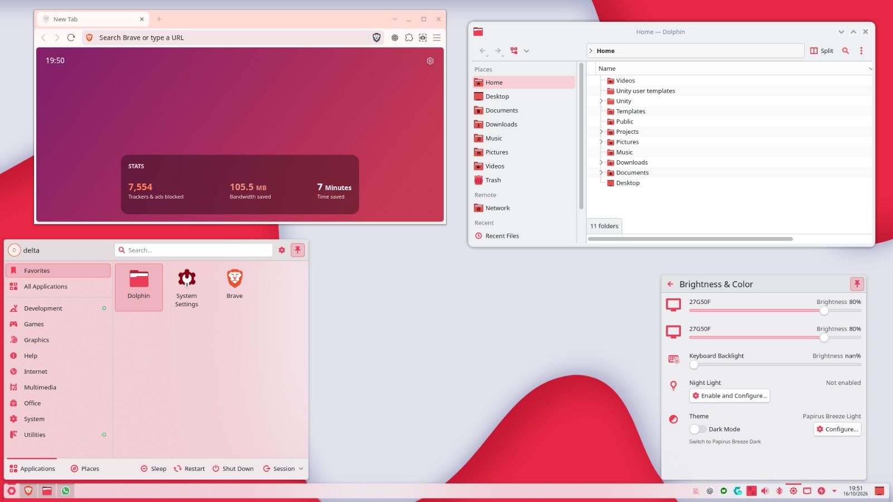
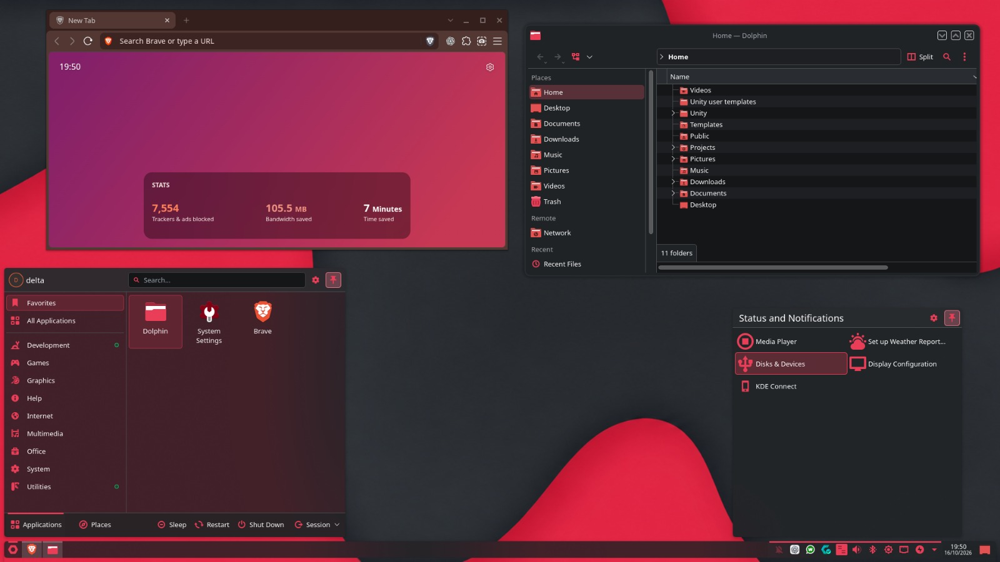

# Appearance and behavior

## Screenshots

### Papirus Breeze Light

Light surfaces, red Papirus icons, Dolphin, the application launcher, and the
Brightness & Color controls with the Light/Dark theme switch.

### Papirus Breeze Dark

Dark surfaces, red Papirus icons, Dolphin, the application launcher, and the
Status and Notifications panel.

## Visual identity

The accent is **`#E93D58`**, RGB `233,61,88`. Ordinary text retains readable
light/dark colors. The general font is Noto Sans 10 pt; KDE animation duration
uses factor `0.25`. The window switcher and splash use Breeze.

| Component | Light | Dark |
| --- | --- | --- |
| Colors | `PapirusBreezeLight`, based on Breeze Light | `PapirusBreezeDark`, based on Breeze Dark |
| Icons | `PapirusBreezeLight`, inherits Papirus | `PapirusBreezeDark`, inherits Papirus-Dark |
| Plasma style | `PapirusBreezeRed` | `PapirusBreezeRed` |
| Qt style | Breeze | Breeze |
| GTK | Breeze, light preference | Breeze-Dark, dark preference |
| Aurorae decoration | `Amy-Light-Aurorae-6` | `Amy-Papirus-Dark` |
| Mouse pointer | `breeze_cursors`, dark, 18 px | `Breeze_Light`, white, 18 px |
| Registered wallpaper | `Moe` | `MoeDark` |

Window decorations use small buttons: menu on the left; minimize, maximize, and
close on the right. The Dark adaptation keeps Amy Light's geometry.

## Quick Settings

The unified installer registers the pair in `[KDE]` of `kdeglobals` using
`DefaultLightLookAndFeel` and `DefaultDarkLookAndFeel`. Reopen System Settings to
refresh its Quick Settings page. Installing without `--apply` does not select a
new appearance. Automatic switching by time of day remains the user's choice.

## Panels

The optional native layout and installation script create one bottom panel per
connected monitor: **32 px**, floating, full width, centered, and adaptively opaque.
Widget order is launcher, pager, icon-only tasks, spacer, system tray, clock,
and Show Desktop. No applications are initially pinned. The launcher has `Alt+F1`.

Application without `--layout` updates existing launcher icons while retaining
panel structure and taskbar favorites. Monitor IDs are resolved on the target
system; only monitors present at application time are configured.

## Red icons

The folder overlay includes **835 aliases**: 539 Papirus Red aliases, 7 recolored
Copy Cloud derivatives, and 289 additional aliases. Generic names such as
`inode-directory`, `gtk-directory`, and `stock_folder` resolve to red folders.

Actions, menus, categories, devices, and tray icons have red variants. Adapted
neutral SVG glyphs use a fixed red so KDE does not recolor them as text. Existing
error, warning, and success indicators retain their semantic roles. Unrelated
applications and brands inherit their original base-theme icons.

Plasma tray icons can come from the Plasma style rather than the icon theme, so
`PapirusBreezeRed` includes matching sprites. Surfaces inherit Breeze and follow
the active palette. Dolphin uses `#E93D58` with `#a62a3e` shading; `org.kde.dolphin`,
`dolphin`, and `system-file-manager` aliases are included.

Empty/full trash icons use explicit `user-trash`/`user-trash-full` and symbolic
aliases at every included size. This prevents KDE's name fallback from selecting
the generic `user` avatar.

## Launcher SVG

`papirus-breeze-launcher.svg` is a rounded red hexagon with a **transparent circular
cutout**. Its center shows the panel background. It contains no embedded bitmap
and uses `fill-rule="evenodd"`. Both icon themes register it under `scalable/apps`.
New layouts and existing-panel updates use the logical name
`papirus-breeze-launcher`, without a personal absolute path.

## Wallpaper, lock screen, and login

Each wallpaper package contains the original light image in `contents/images/`
(3073 × 1420) and the dark image in `contents/images_dark/` (1844 × 853).
Desktop and lock-screen settings reference the package directory so Plasma can
choose the matching image. Selecting a single image manually fixes that image.

The lock screen uses native KDE UI and the adaptive wallpaper package, so a palette
change selects its Light/Dark image without replacing the authentication UI.
Login appearance needs administrative installation because the greeter runs as
another account; unified installation now requests this by default. With
`--follow-user`, palette, icons, cursor, and wallpaper follow
the Papirus Light/Dark selection. Otherwise the selected appearance stays static.
The watcher selects fixed profiles installed by root and uses the native greeter
interface. Greeter `Colors:Complementary` matches window colors; desktop palettes
are unchanged. See [installation](INSTALLATION.md#login-appearance).

## Konsole

Both packages include `Papirus Breeze Light` and `Papirus Breeze Dark` profiles.
The `LightDarkTheme` group in `konsolerc` enables native system-palette following
on supported Konsole versions. Reopen Konsole after the first configuration.

- White Light background; charcoal Dark background; opacity 1 and no blur.
- JetBrainsMono Nerd Font, 11 pt; initial size 96 columns × 24 lines.
- ANSI palettes adapted for readability and a red accent.
- A red `#E93D58` block cursor with blinking and animation.
- Cursor text color `20,22,24`; history of 10,000 lines.
- Initial command `fish`; unrelated profiles remain available.

The terminal cursor is independent of the mouse pointer theme.

## Fish

The greeting shows distribution/architecture, kernel, and desktop/Fish version on
three lines. A managed block at the end of `fish/config.fish` sources
`fish/papirus-breeze.fish` only for interactive sessions, after the distribution
configuration. It does not use an ASCII logo or Fastfetch.

When Pure is already installed, its settings request a compact single-line red
prompt. Session-global variables are used; the installer does not replace
`fish_variables`, change the login shell, or discard distribution aliases.
